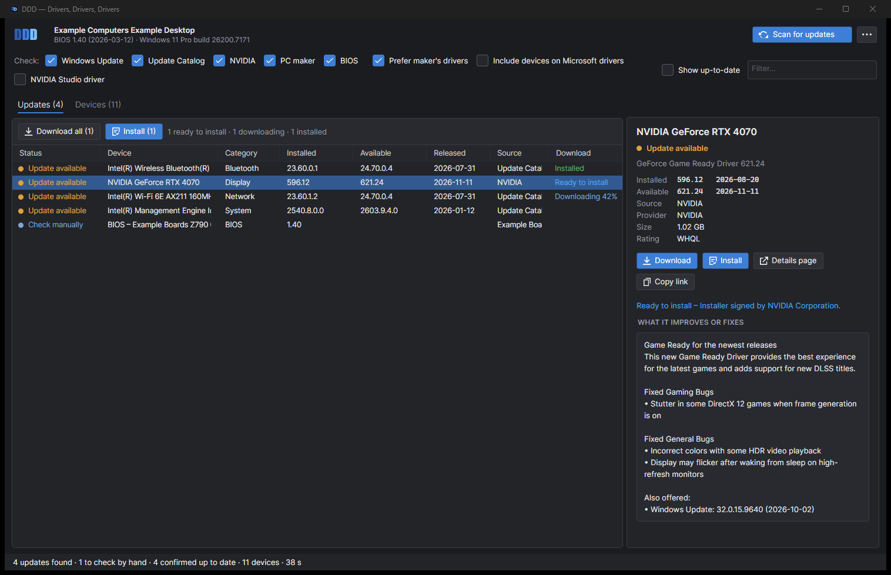
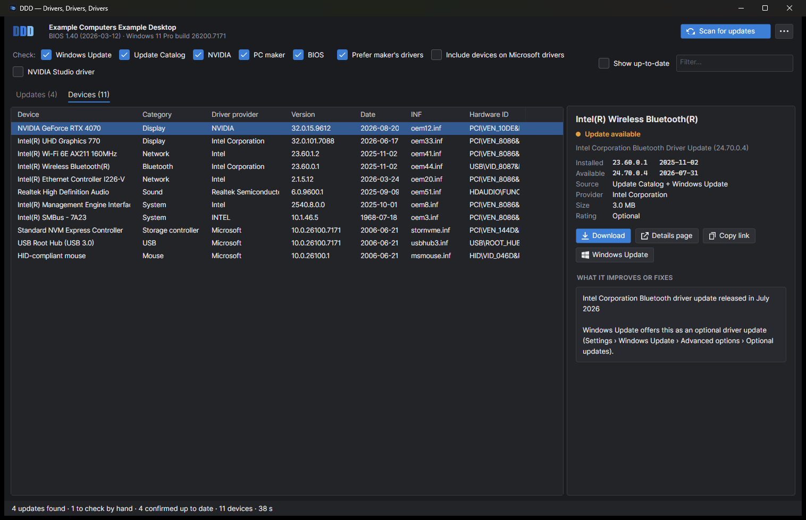
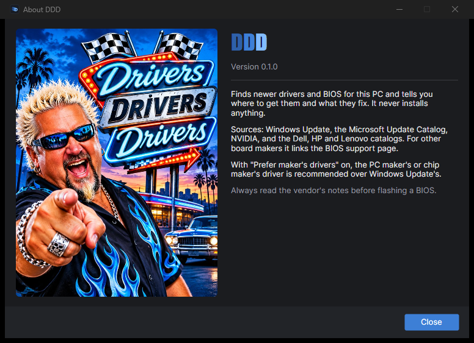

# DDD — Drivers, Drivers, Drivers

A dark Windows tool that checks the drivers and BIOS on your PC, finds newer versions, shows
**notes on what each update improves or fixes**, and can **download and install** them for you.



## Download

From [Releases](https://github.com/Taoism/DDD/releases/latest):

- **`DDD-<version>-setup-win-x64.exe`** — installer. Installs for your user without an administrator
  prompt (or for all users), adds a Start menu entry, and can add `ddd-cli` to PATH.
- **`DDD-<version>-portable-win-x64.zip`** — portable. Unzip anywhere (a USB stick works); settings and
  cached catalog searches stay in the `Data` folder next to `DDD.exe`. Delete `portable.txt` to make it
  use `%APPDATA%\DDD` instead.

Both are self-contained (no .NET install needed) and include the app (`DDD.exe`) and the command-line
tool (`ddd-cli.exe`). Windows 10 1809 or later, x64. `SHA256SUMS.txt` lists the checksums.

## Download and install

**Download all** fetches every update into `%TEMP%\DDD\downloads` and checks it before use: Microsoft's
SHA-1 from the file name for Update Catalog packages, the vendor's SHA-256 for Dell, HP and Lenovo, and a
valid digital signature for every installer (`.exe`). Driver `.cab` packages are extracted.

**Install** (enabled once something downloaded and checked out) installs them:
- driver packages with Windows' own `pnputil /add-driver … /install`, all in one run with a single
  administrator prompt; DDD first tries to create a System Restore point;
- vendor installers (NVIDIA, Dell, HP, Lenovo) open one after another.

BIOS updates are only downloaded, never flashed by DDD: read the vendor's notes and run the update yourself
(**Open folder**). Each line shows its state (Downloading 42% → Ready to install → Installed). If Windows ranks
the driver it has the same or better, pnputil only adds the new one to the driver store; Device Manager can
switch to it.

## Where it looks

| Source | What it checks | Notes come from |
| --- | --- | --- |
| **Windows Update** | Driver updates Windows Update has for this PC, including optional ones (Windows Update Agent API) | Update description; direct `.cab` link from the Update Catalog |
| **Microsoft Update Catalog** | Every device with a vendor driver, looked up by hardware ID; often newer than what Windows Update offers | Catalog details page (description, models, Windows versions) |
| **NVIDIA** | GeForce cards, by PCI device ID (Game Ready or Studio) | NVIDIA's release highlights and fixed-bug list |
| **PC maker drivers: Dell, HP, Lenovo** | The maker's driver packages for this model, matched to devices by hardware ID | Package release notes / readme |
| **BIOS: Dell, HP, Lenovo** | The makers' own update catalogs (the ones Dell Command Update, HP Image Assistant and Lenovo System Update read) | Vendor readme / release notes |
| **BIOS: MSI, ASUS, Gigabyte, ASRock, others** | No public catalog, so DDD shows the installed version and links the board's BIOS page | — |

### Maker's drivers first

With **Prefer maker's drivers** on (the default), each device gets one recommendation, chosen in this
order: the PC maker (Dell, HP, Lenovo), the chip maker (NVIDIA), the vendor's own driver in the Update
Catalog, and only then Windows Update — even when Windows Update has a higher version. The other offers
are listed in the notes ("Also offered: …"), and a Windows Update driver for a device whose maker driver
is already current is marked Optional. Turn it off to recommend the highest version instead.



## Use

- **App**: press **Scan for updates** (F5), select a line to read what it fixes, then **Download**,
  **Details page** or **Release notes**. **⋯ › Export report** saves an HTML or JSON report.
  `DDD.exe --scan` scans at start; `DDD.exe --demo` shows a made-up PC (used for these screenshots).
- **Command line**:
  ```
  ddd-cli scan [--all] [--json] [--html FILE] [--no-wu] [--no-catalog] [--no-nvidia] [--no-oem]
               [--no-bios] [--no-prefer] [--ms-drivers] [--studio] [--fresh]
  ddd-cli devices
  ddd-cli system
  ddd-cli model dell|hp|lenovo ID     what a maker publishes for a model (system SKU / platform ID / machine type)
  ```

No administrator rights needed. Searches of the Update Catalog are paced (one at a time) and cached for
6 hours, because the catalog answers "Too many search requests" when searched quickly.



## Build

```
dotnet build DDD.slnx
dotnet test tests/DDD.Tests
.\build-release.ps1          # installer + portable zip into .\release (needs Inno Setup 6)
```

`src/DDD.Core` (inventory, sources, reports), `src/DDD.Cli` (`ddd-cli.exe`), `src/DDD` (Avalonia app),
`tests/DDD.Tests` (xUnit).

## License

MIT — see [LICENSE](LICENSE). Third-party components: [THIRD-PARTY-NOTICES.txt](THIRD-PARTY-NOTICES.txt).
Drivers and BIOS files come from the vendors' own servers and stay under their licenses.
